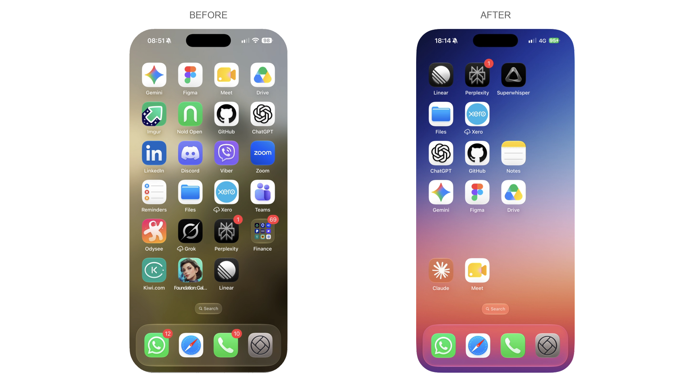
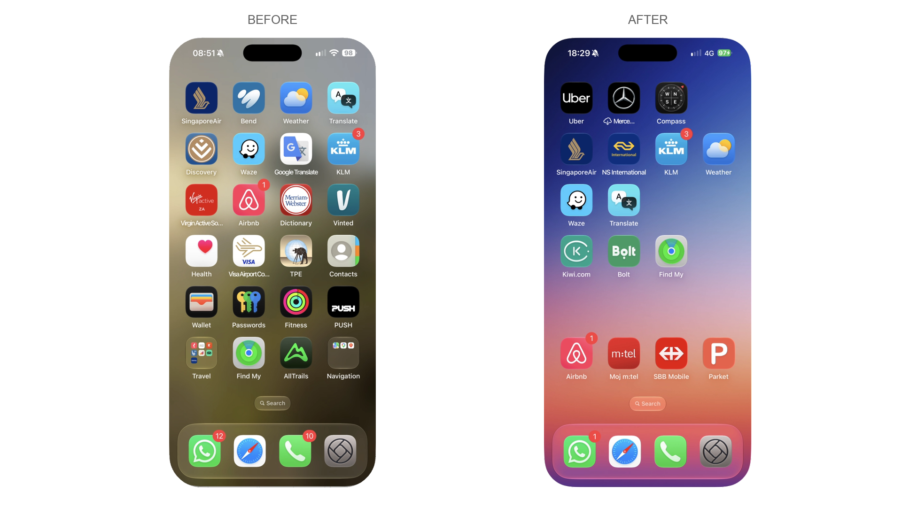
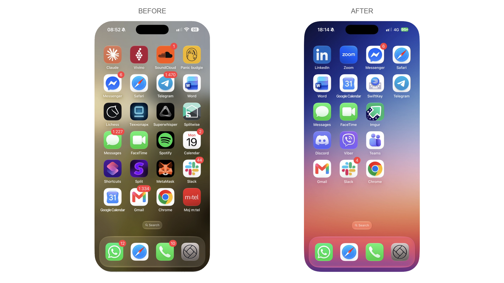

# iPhone Home Screen skill

A skill for Claude Code and Codex that tidies a real iPhone Home Screen from a Mac. It groups apps by purpose, orders icons by colour, lines the colours up with a gradient wallpaper, keeps the dock, widgets and folders, and never deletes an app unless you say so.





The pictures are from the author's own phone. The apps on each page differ because the apps were regrouped across pages.

## Where this stands

It has been tested on one phone: an iPhone 16 Pro Max on iOS 27.0.1, with macOS 26.6.2 on an Apple silicon Mac. Nobody else has run it yet, which is why it needs testers.

The parts that only read are safe to try. They read your layout over USB, report your pages, folders and widgets, and say what a reorganisation would involve. They write nothing to your phone.

The part that moves icons works through iPhone Mirroring with held mouse drags. It is slow: expect hours for a full rebuild, mostly spent on the drags. There is no measured time per move yet, and the skill includes a timer so testers can produce one.

## What you need

To read your phone and plan (no changes to the phone):
- A Mac and an iPhone joined by a USB data cable, with "Trust This Computer" accepted.
- Python and pymobiledevice3 (tested with 11.36.0). The skill asks before installing anything.

To move icons through iPhone Mirroring, Apple's published requirements apply:
- macOS 15 or later on a Mac with Apple silicon or a T2 chip, and iOS 18 or later with a passcode set.
- The same Apple Account on both with two-factor, Bluetooth and Wi-Fi on, the iPhone locked and near the Mac, and no AirPlay, Sidecar or Internet Sharing.
- iPhone Mirroring is not available in the European Union, according to Apple, so in the EU only the read-and-plan part applies.
- Xcode Command Line Tools for the small drag helper, and Accessibility permission for the app that runs it.

`scripts/preflight.py` checks all of this and changes nothing.

## Install

Copy the skill folder into your agent's skills folder.

For Claude Code:

```bash
cp -R skills/iphone-home-screen ~/.claude/skills/
```

For Codex:

```bash
cp -R skills/iphone-home-screen ~/.codex/skills/
```

Then ask your agent: "Use the iphone-home-screen skill to run the requirements check and a dry run on my iPhone."

## Help me test it

Start with the dry run, which changes nothing. If you are happy to go further, `skills/iphone-home-screen/references/testing.md` describes a few-icon test on one page, and then a full run with the move timer on. What I would like back: the output of `preflight.py --json`, the dry-run summary, and anything that went wrong. Please do not send your layout file unless you are happy for me to see your apps.

## What it will not do

It will not erase, supervise, restore or jailbreak your phone, and it will not delete an app without your approval. It stops on any "Remove App" or "Delete App" prompt, any dialog, or any new folder created by accident.

## What the research found

Apple's USB layout service cannot carry empty cells, so any tool that writes the layout that way closes the gaps. The phone does store exact cell positions, but the USB read leaves them out. That is why the skill places gaps by dragging. Routes that looked promising and were ruled out include Apple Configurator, Shortcuts, backup editing, device management profiles and the exploit-based tools. One route is untested and left switched off: writing the layout as a dictionary that carries the positions. Another is touch control over USB on iOS 27, which is also untested.

## Credits

Built on [pymobiledevice3](https://github.com/doronz88/pymobiledevice3). The wallpaper in the pictures is Gradients of September 2025 by Basic Apple Guy.

## Licence

MIT. See LICENSE.
